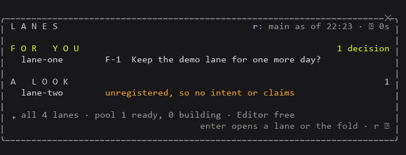
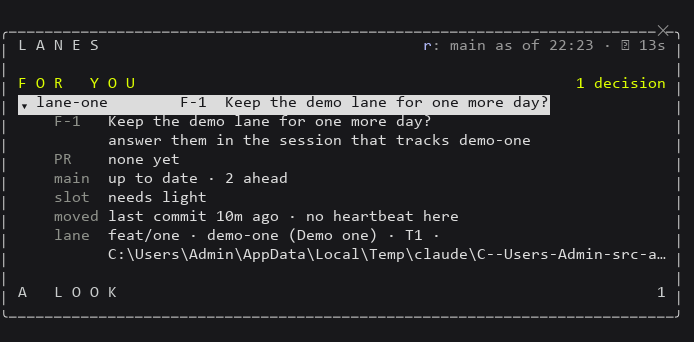
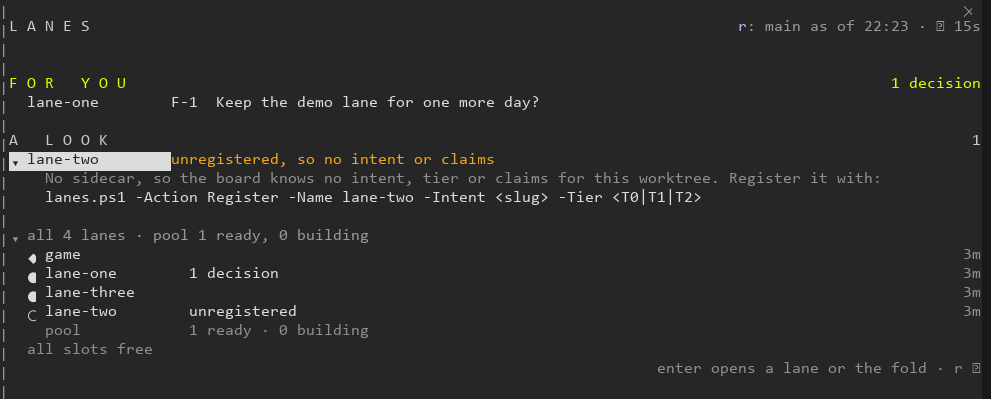
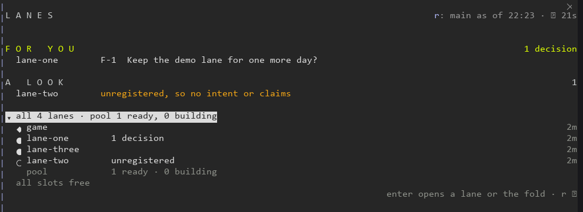
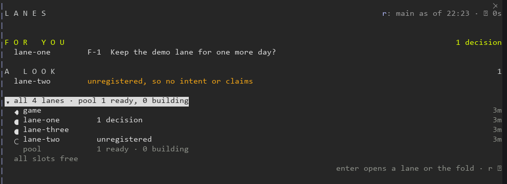
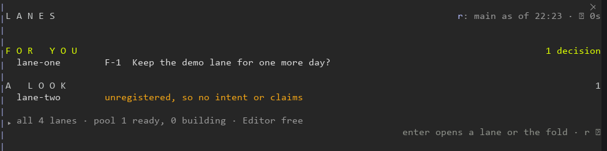
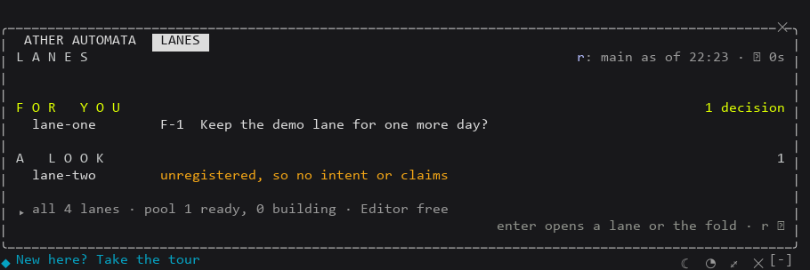

# Ather Lanes: the live pane beside the agreed design

Captures of a live Claude Code session (2.1.296) with Ather Lanes loaded by `--plugin-dir`, driven headlessly in a Windows pseudo-console. The screen is drawn to PNG with the driver's fonts, which render ◆ ● ○ ↻ poorly; the text under each capture is the exact screen. The machine is a scratch one in the worker's temp folder: a lane 0 named `game`, four worktrees beside it (`lane-one` and `lane-three` registered, `lane-two` not, `_pool-01` in the pool), its own `_machine`, and the real lane scripts copied in. Each section follows [design.md](../design.md) in its order.

The scripts that read the captures and the trace are [compare.mjs](compare.mjs) (A3: the opened fold's lanes against `lanes.ps1 -Action Status -Json` at the same moment) and [trace.mjs](trace.mjs) (A4: git's trace and the mod's spawn log).

## Terminal, 72 columns, at rest

design.md: For you (lime), A look (each reason amber), one folded line, a header with `origin/main`'s age and the last refresh, one quiet hint line.



```
L A N E S                                     r: main as of 22:23 · ↻ 0s

F O R   Y O U                                                 1 decision
  lane-one        F-1  Keep the demo lane for one more day?

A   L O O K                                                            1
  lane-two        unregistered, so no intent or claims

▸ all 4 lanes · pool 1 ready, 0 building · Editor free
                                     enter opens a lane or the fold · r ↻
```

The `r:` before the header's right side is the terminal's hotkey for ↻. At 72 columns every line fits; the first capture of this view, before a fix, wrapped the header because the hotkey's three cells were not counted (fixed in 2d30957, now tested).

## A lane opened in place

design.md: the item gains ▾ and its details open under it, one label a line: decisions, PR, main, slot, moved, lane.



```
▾ lane-one        F-1  Keep the demo lane for one more day?
    F-1   Keep the demo lane for one more day?
          answer them in the session that tracks demo-one
    PR    none yet
    main  up to date · 2 ahead
    slot  needs light
    moved last commit 10m ago · no heartbeat here
    lane  feat/one · demo-one (Demo one) · T1 ·
          <the scratch path>
```

An unregistered lane opens to one sentence and the Register line to copy:



```
▾ lane-two        unregistered, so no intent or claims
    No sidecar, so the board knows no intent, tier or claims for this worktree. Register it with:
    lanes.ps1 -Action Register -Name lane-two -Intent <slug> -Tier <T0|T1|T2>
```

At 72 columns the Register line breaks with PowerShell's backtick, so the two lines still paste as one command (unit test).

## The fold opened: every lane

design.md: one line a lane (lane 0 first, then by name), at most one phrase and its last-moved age, the pool on one line, then the held slots or "all slots free".



```
▾ all 4 lanes · pool 1 ready, 0 building
  ◆ game                                                     2m
  ● lane-one        1 decision                               2m
  ● lane-three                                               2m
  ○ lane-two        unregistered                             2m
    pool            1 ready · 0 building
  all slots free
```

`node compare.mjs` on this capture against a fresh Status: `same lanes` (game, lane-one, lane-three, lane-two + 1 pool). The phrase is in ink, not lime or amber (F-10).

A slot taken and released while the fold is open (A2 ii): `editor-slot.ps1 -Action Take -Kind light -Lane lane-one -Isolated` on the scratch machine folder showed 8 s later, and its release cleared 19 s later.


```
  light-1  lane-one · light · 29m left
```



## Wider terminals

design.md: the same layout at 110 columns, titles and reasons cut later, no extra columns. Docked beside the chat at 107 columns:



## Beside Ather Automata

Both mods loaded in one session (A5): `/ather` and `/lanes` open as two tabs of one pane, and both draw.



## Desktop side panel

Not captured: loading a mod into the Claude desktop app means installing it there, a change to the user's settings that the worker does not make. The desktop surface is drawn and pressed by `claude plugin test ather-lanes` (FOR YOU with each lane in bold, A LOOK, the fold as a button and the Editor slot line), and the owner can capture it after installing the release.
