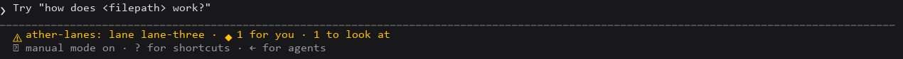
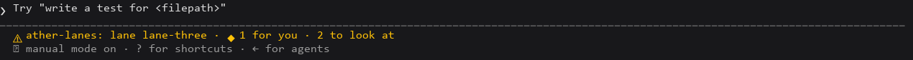
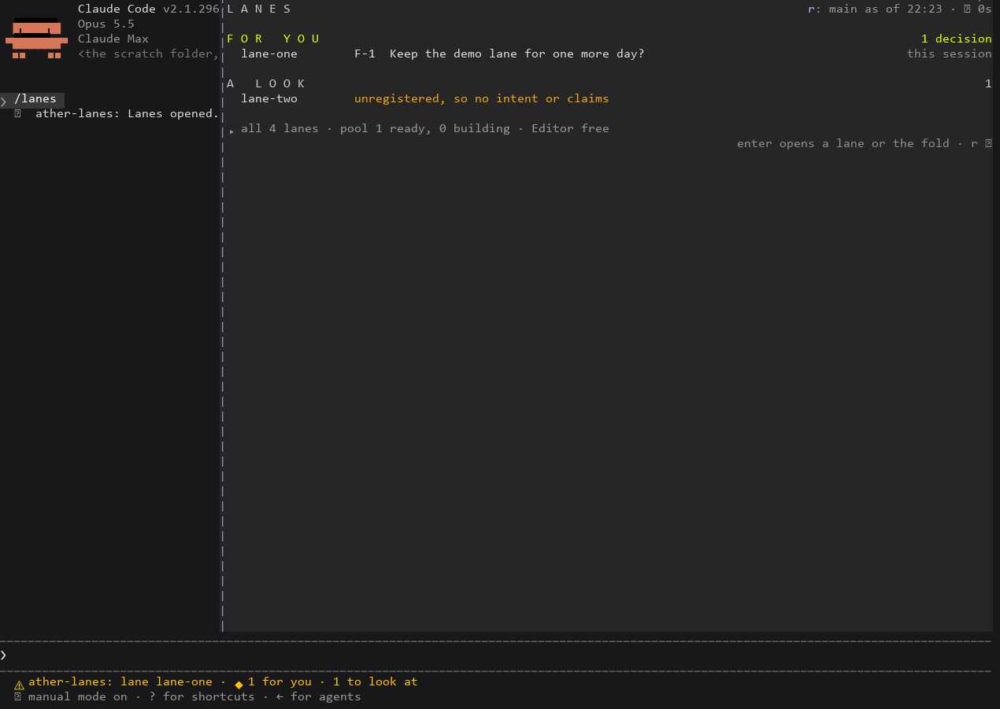
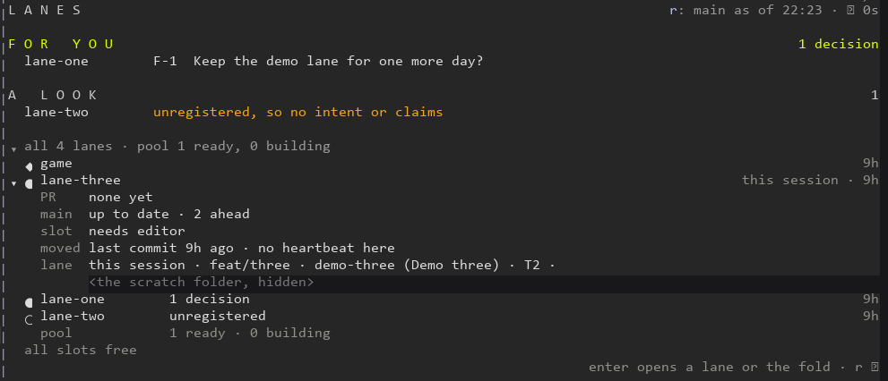
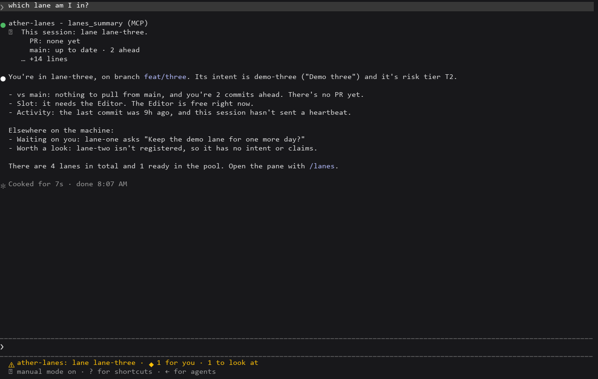
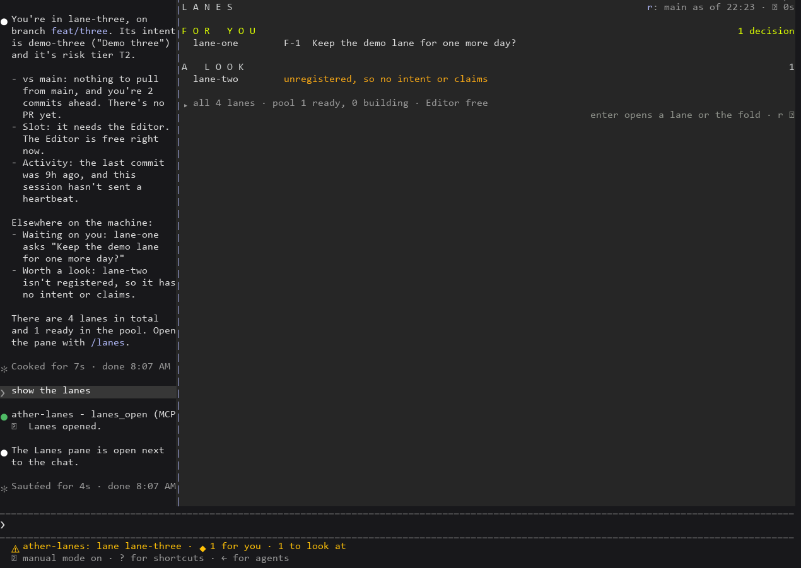

# Ather Lanes: the live pane beside the agreed design

Captures of a live Claude Code session (2.1.296) with Ather Lanes loaded by `--plugin-dir`, driven headlessly in a Windows pseudo-console. The screen is drawn to PNG with the driver's fonts, which render ◆ ● ○ ↻ poorly; the text under each capture is the exact screen. The machine is a scratch one in the worker's temp folder: a lane 0 named `game`, four worktrees beside it (`lane-one` and `lane-three` registered, `lane-two` not, `_pool-01` in the pool), its own `_machine`, and the real lane scripts copied in. Each section follows [design.md](../design.md) in its order.

The scripts that read the captures and the trace are [compare.mjs](compare.mjs) (A3: the opened fold's lanes against `lanes.ps1 -Action Status -Json` at the same moment) and [trace.mjs](trace.mjs) (A4: git's trace and the mod's spawn log).

## Terminal, 72 columns, at rest

design.md: For you (lime), A look (each reason amber), one folded line, a header with `origin/main`'s age and the last refresh, one quiet hint line.


```
L A N E S                                     r: main as of 22:23 · ↻ 0s

F O R   Y O U                                                 1 decision
  lane-one        F-1  Keep the demo lane for one more day?

A   L O O K                                                            1
  lane-two        unregistered, so no intent or claims

▸ all 4 lanes · pool 1 ready, 0 building · Editor free
                                     enter opens a lane or the fold · r ↻
```

The `r:` before the header's right side is the terminal's hotkey for ↻. At 72 columns every line fits; the first capture of this view, before a fix, wrapped the header because the hotkey's three cells were not counted (fixed in 2d30957, now tested).

## A lane opened in place

design.md: the item gains ▾ and its details open under it, one label a line: decisions, PR, main, slot, moved, lane.


```
▾ lane-one        F-1  Keep the demo lane for one more day?
    F-1   Keep the demo lane for one more day?
          answer them in the session that tracks demo-one
    PR    none yet
    main  up to date · 2 ahead
    slot  needs light
    moved last commit 10m ago · no heartbeat here
    lane  feat/one · demo-one (Demo one) · T1 ·
          <the scratch path>
```

An unregistered lane opens to one sentence and the Register line to copy:


```
▾ lane-two        unregistered, so no intent or claims
    No sidecar, so the board knows no intent, tier or claims for this worktree. Register it with:
    lanes.ps1 -Action Register -Name lane-two -Intent <slug> -Tier <T0|T1|T2>
```

At 72 columns the Register line breaks with PowerShell's backtick, so the two lines still paste as one command (unit test).

## The fold opened: every lane

design.md: one line a lane (lane 0 first, then by name), at most one phrase and its last-moved age, the pool on one line, then the held slots or "all slots free".


```
▾ all 4 lanes · pool 1 ready, 0 building
  ◆ game                                                     2m
  ● lane-one        1 decision                               2m
  ● lane-three                                               2m
  ○ lane-two        unregistered                             2m
    pool            1 ready · 0 building
  all slots free
```

`node compare.mjs` on this capture against a fresh Status: `same lanes` (game, lane-one, lane-three, lane-two + 1 pool). The phrase is in ink, not lime or amber (F-10).

A slot taken and released while the fold is open (A2 ii): `editor-slot.ps1 -Action Take -Kind light -Lane lane-one -Isolated` on the scratch machine folder showed 8 s later, and its release cleared 19 s later.


```
  light-1  lane-one · light · 29m left
```


## Wider terminals

design.md: the same layout at 110 columns, titles and reasons cut later, no extra columns. Docked beside the chat at 107 columns:


## Beside Ather Automata

Both mods loaded in one session (A5): `/ather` and `/lanes` open as two tabs of one pane, and both draw.


## On the real lanes (owed, F-11)

The worker could not open a session in the main checkout or a lane: Claude Code runs `git status` in its working folder when a session starts. For the owner, from a session already open there:

1. A session-only settings file (no user setting changes) naming a folder with the lane scripts: `{ "pluginConfigs": { "ather-lanes": { "options": { "scriptsDir": "<a checkout's .agents\\skills\\s2-agent-lanes\\scripts>" } } } }`
2. `claude --plugin-dir <ather-lanes> --settings <that file>` in the main checkout, then `/lanes` and Enter on the fold.
3. Copy the screen to a text file, then `node compare.mjs <screen.txt> <scriptsDir>\lanes.ps1 <the main checkout>`: it prints `same lanes`, or what differs.

## Desktop side panel

Not captured: loading a mod into the Claude desktop app means installing it there, a change to the user's settings that the worker does not make. The desktop surface is drawn and pressed by `claude plugin test ather-lanes` (FOR YOU with each lane in bold, A LOOK, the fold as a button and the Editor slot line), and the owner can capture it after installing the release.

# Rev 4: the status line, the tools and this session's lane

These are captures of live sessions of Claude Code 2.1.296 on the same scratch machine, with Ather Lanes 0.2.0 loaded by `--plugin-dir` from a frozen copy of 35ffbff and a session-only `--settings` file. Each session was opened in a lane: `lane-one` (registered, with one decision) or `lane-three` (registered, no decision). In the PNGs, a row that names the scratch folder (the worker's temp folder) is covered, and the cover says so.

## The status line, the pane closed (A7)



```
❯ Try "how does <filepath> work?"
  ⚠ ather-lanes: lane lane-three · ◆ 1 for you · 1 to look at
```

A full slot was taken for `lane-one` on the scratch machine folder at 08:26:57 (`editor-slot.ps1 -Action Take -Kind full -Lane lane-one -Isolated`), with the pane closed. By 08:27:59 the line in `lane-three`'s session (that lane needs the Editor) had moved from `1 to look at` to `2 to look at`. After the release at 08:28:06 it read `1 to look at` again at 08:29:09. Both changes landed within 65 s, and the session's debug log names no spawn at all.



The line is there from the session's start, read from files alone (D8). The engine prefixes `⚠ ather-lanes:` and draws the line in its own warning colour: `$.ui.status` takes plain text, so the counts can't be lime or amber, and the line takes no press (F-13). `/lanes` or the `lanes_open` tool opens the pane.

## The status line beside the open pane, "this session" marked (A7, A9)



```
F O R   Y O U                                                     1 decision
  lane-one        F-1  Keep the demo lane for one more day?     this session
A   L O O K                                                                1
  lane-two        unregistered, so no intent or claims
▸ all 4 lanes · pool 1 ready, 0 building · Editor free
  ⚠ ather-lanes: lane lane-one · ◆ 1 for you · 1 to look at
```

The line's counts are the pane's: 1 decision in For you, 1 lane in A look.

## The opened fold: this session's lane right after lane 0 (A9)

The session in `lane-three` asked Claude to "open lane-three in the lanes pane", and the `lanes_open` tool opened the lane in place. `lane-three` comes after lane 0 (`game`) and before `lane-one`, which sorts first by name.



```
▾ all 4 lanes · pool 1 ready, 0 building
  ◆ game                                                                    9h
▾ ● lane-three                                                this session · 9h
    PR    none yet
    main  up to date · 2 ahead
    slot  needs editor
    moved last commit 9h ago · no heartbeat here
    lane  this session · feat/three · demo-three (Demo three) · T2 ·
          <the scratch folder>
  ● lane-one        1 decision                                              9h
  ○ lane-two        unregistered                                            9h
    pool            1 ready · 0 building
  all slots free
```

## Claude calls the tools (A8)

"which lane am I in?": Claude called `lanes_summary` and answered from its text. The pane was closed, so no process ran. The "main" figures come from the full read the earlier session's pane kept in the store.



```
❯ which lane am I in?
● ather-lanes - lanes_summary (MCP)
  ⎿  This session: lane lane-three.
       PR: none yet
       main: up to date · 2 ahead
     … +14 lines
● You're in lane-three, on branch feat/three. Its intent is demo-three ("Demo three") and it's risk tier T2.
  ...
  - Waiting on you: lane-one asks "Keep the demo lane for one more day?"
  - Worth a look: lane-two isn't registered, so it has no intent or claims.
```

"show the lanes": Claude called `lanes_open`, and the pane opened beside the chat.



```
❯ show the lanes
● ather-lanes - lanes_open (MCP)
  ⎿  Lanes opened.
● The Lanes pane is open next to the chat.
```

## A4 again, on the final code (rev 4)

The run followed S7's method. The session ran in lane 0 (`game`) with Ather Lanes 0.2.0 alone, `GIT_TRACE2_EVENT` and `--debug-file`. It went one minute with no pane, then the pane was open for 10 minutes (with one `r` at 5), then Escape, then 5 minutes closed. For the whole session the status line was kept fresh from files: `lane 0 · ◆ 1 for you · 1 to look at`. `node trace.mjs t4-trace.json t4-debug.log t4-times.txt`:

```
git processes in the trace: 35; the mod's: 24 (Status' 18, for-each-ref 6)
open 10 min, then closed 5 min; spawns while open: powershell 6, git 6, gh 0
git per Status run: 3, 3, 3, 3, 3, 3 (rev-parse --show-toplevel | worktree list --porcelain)
ok   no git of the mod’s and no spawn before the pane opened
ok   none of the mod’s git runs status, fetch, diff or merge-tree
ok   no two of the mod’s git overlap
ok   each Status run started exactly three git
ok   PowerShell at most 7 (6 plus one per r), gh at most 3
ok   no git of the mod’s and no spawn while closed
A4: pass
```
