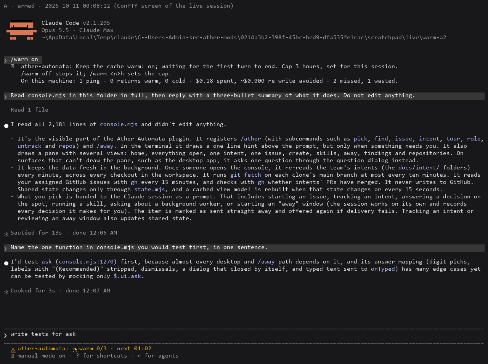
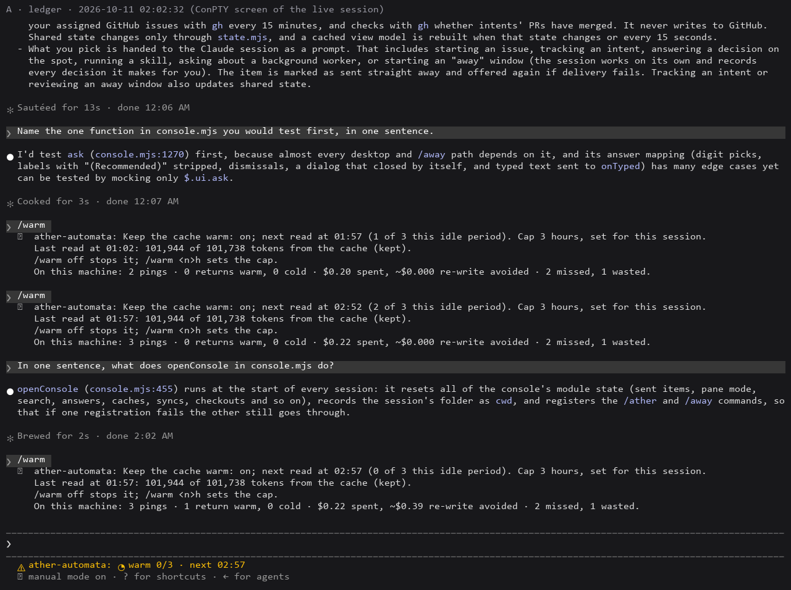
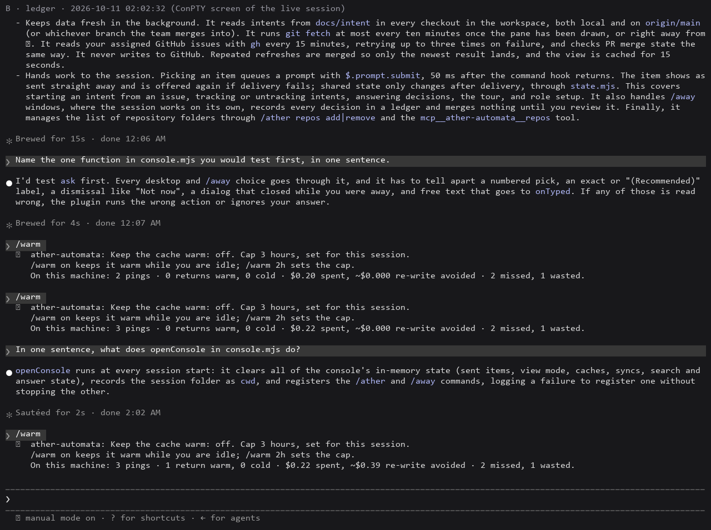
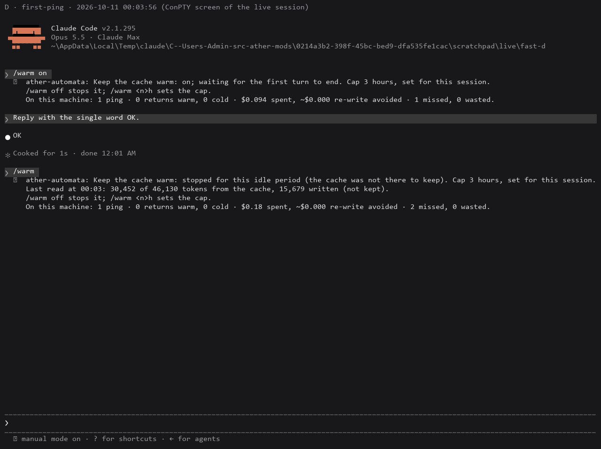
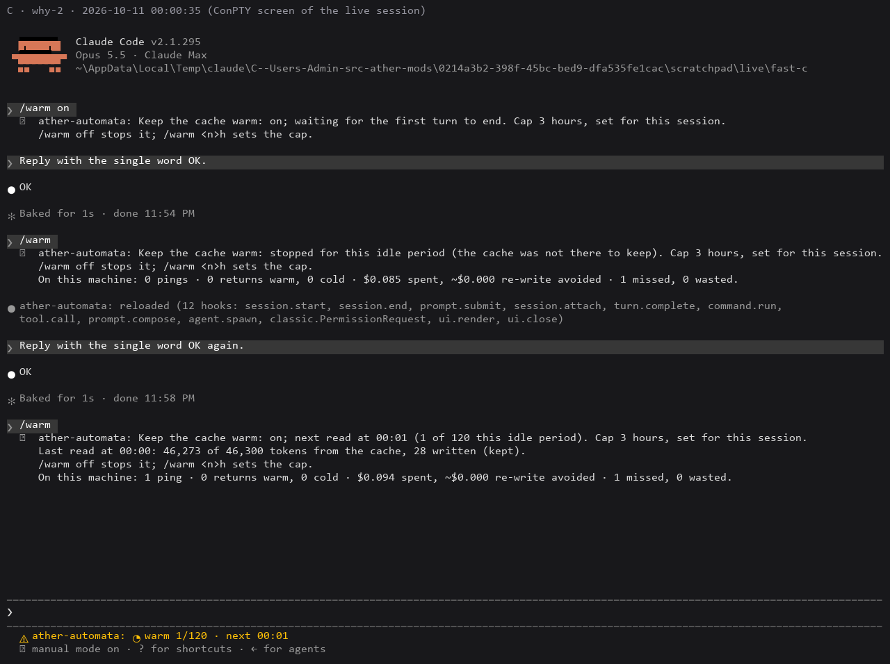
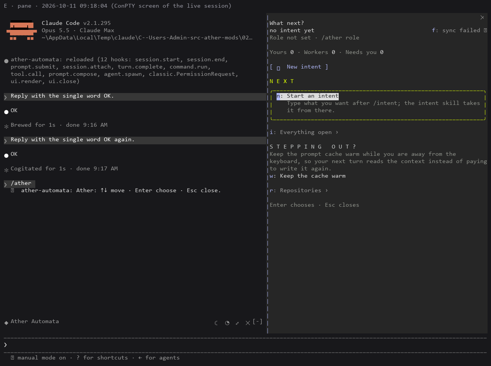
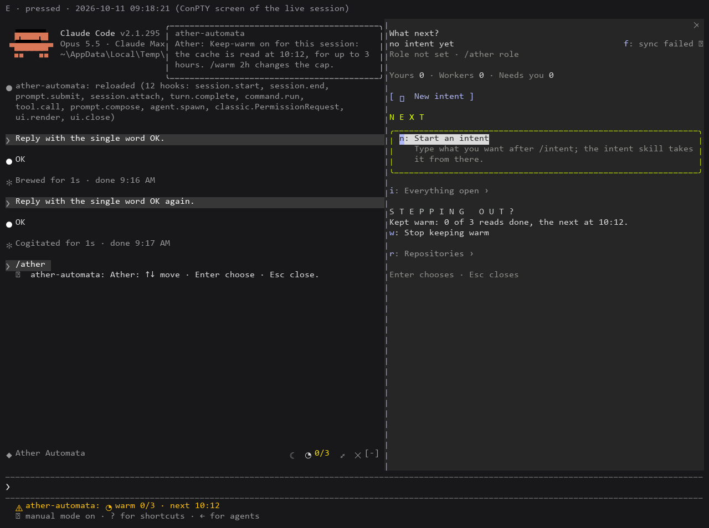
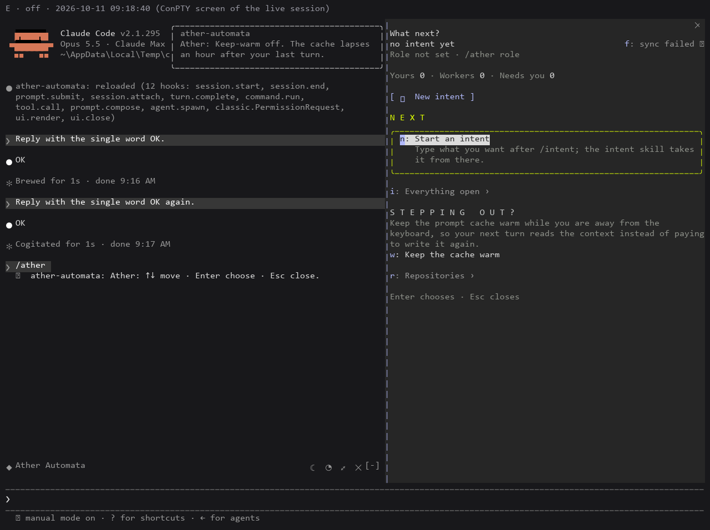

# cache-keep-warm: live proof (A1)

Two interactive Claude Code sessions (2.1.295, Opus 5.5, Claude Max), each loading this branch's plugin frozen at a7704de with `--plugin-dir`, started together on 2026-10-11 in two empty scratch folders holding a copy of `console.mjs`. Each was driven headlessly in a Windows pseudo-console by [drive.py](drive.py), which renders its screen to PNG. Per-response usage comes from each session's own transcript, read by [usage.py](usage.py) ([transcript-usage.txt](transcript-usage.txt)).

| | Session A | Session B (control) |
| --- | --- | --- |
| Setting | `/warm on` | `/warm off` |
| Turn 1, 00:06 | read console.mjs, summarize (3 requests) | the same |
| Turn 2, 00:07 | one sentence (context now ~101.7k tokens) | the same |
| Idle | read at 01:02 and 01:57, each "101,944 of 101,738 tokens from the cache (kept)" | nothing |
| Turn 3, 02:02:06 (115 min after turn 2) | the same prompt | the same prompt |
| Turn 3 cache read | **101,944** | **27,862** (only the system prompt every session shares) |
| Turn 3 cache write | **495** | **74,663** (the conversation written again) |

In units of the base input price (read 0.1x, one-hour write 2x), turn 3 cost B 2,786 + 149,326 = **152,112**; it cost A 10,194 + 990 = 11,184, plus its two reads, about 10,200 each: **~31,600 in all, about a fifth of B**. By the session's own cost ledger each read cost $0.020 (two: $0.0401); `/warm` estimates the re-write avoided at ~$0.39 (19 reads' worth).

A after its return: both reads kept, the return counted warm ("3 pings · 1 return warm · $0.22 spent, ~$0.39 re-write avoided"; the machine-wide ledger also holds the diagnostic sessions C and D: 2 missed, 1 wasted, $0.18).

B, the same prompt at the same moment:

## The first turn (F-2)

Before this run, sessions C and D (a copy of the plugin whose margin was 58.5 minutes, so it read 90 seconds after a turn) showed that a session's first request is never read from the cache again. D's read after its first turn: "30,452 of 46,130 tokens from the cache, 15,679 written (not kept)". C's own second turn, 3.5 minutes after its first, read only 30,391 and wrote 15,907. After C's second turn its read was "46,273 of 46,300 tokens from the cache, 28 written (kept)". Hence D10: keep-warm starts from the session's second turn.

## The ◔ and Stepping out? (A10)

Session E (Claude Code 2.1.295) ran the plugin at 35f27b2's code in a scratch git checkout holding two intents, so the row above the prompt and the pane are drawn. After two short turns, `/ather` opened the pane: Stepping out? offers **w: Keep the cache warm**, and the row's ◔ is dim.

`w` pressed in the pane: the toast "Keep-warm on for this session: the cache is read at 10:12, for up to 3 hours. /warm 2h changes the cap.", the pane's "Kept warm: 0 of 3 reads done, the next at 10:12." with **w: Stop keeping warm**, the row's ◔ with **0/3** in amber, and the status line `◔ warm 0/3 · next 10:12`.

`w` again: "Keep-warm off. The cache lapses an hour after your last turn.", the ◔ dim without a count, the status line cleared.

